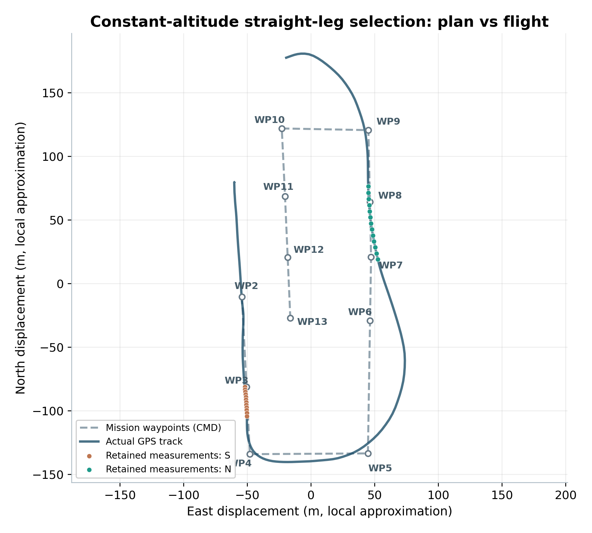
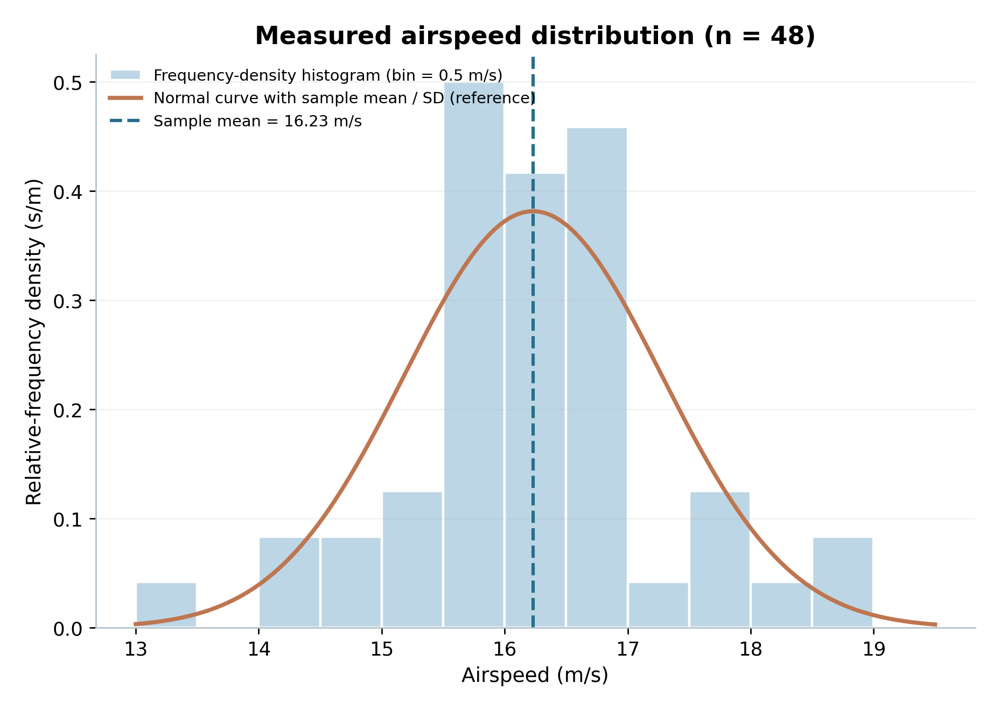
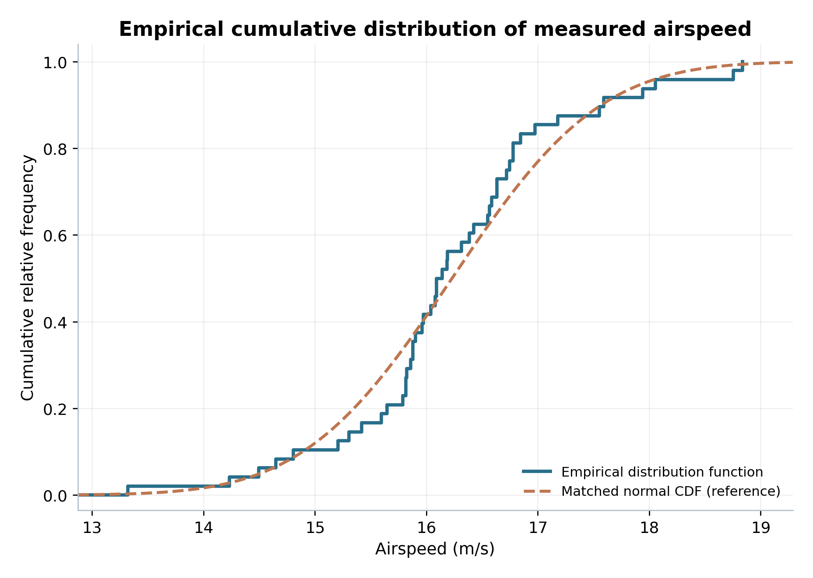
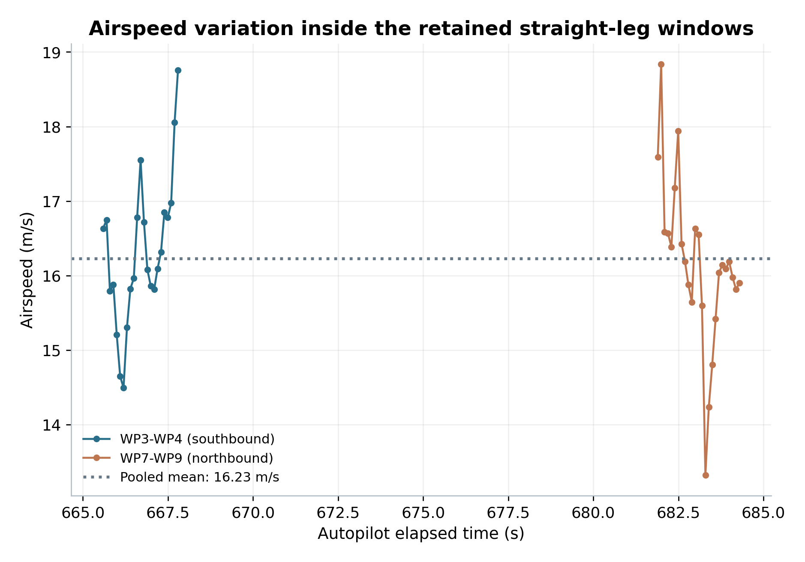
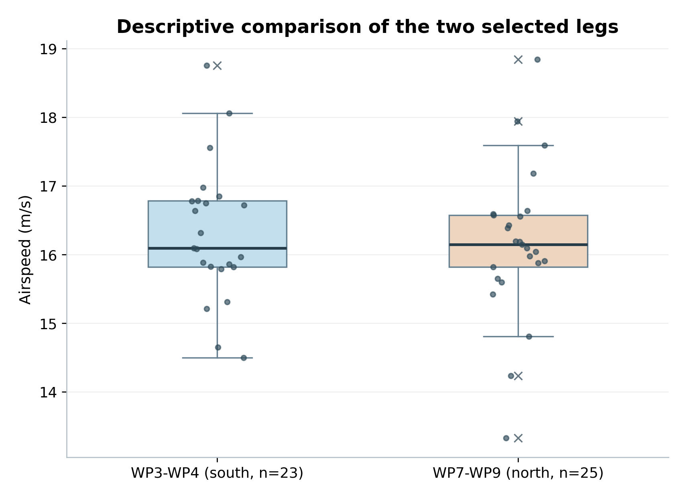

# 概率论与数理统计大作业

**课程：** 概率论与数理统计 X（2026 年秋）  
**学号：** 2025110222　**姓名：** 李睿晰　**班号：** 2508311  
**实验训练 1：** 基于固定翼无人机飞行日志的近似定高直线航段空速分布统计分析  
**实验训练 2：** 两种零件抗拉强度的区间估计与假设检验

> **数据与复现说明：** 实验训练 1 使用真实 ArduPilot DataFlash 日志 `00000172(1).BIN` 提取的 48 条机载空速记录；实验训练 2 使用课程任务给定的 10 个抗拉强度观测值。R 语言完整源程序见 `src/02_analysis.R`，原始与筛选数据均包含在交付包中。本报告中的数值、图表已在交付端完成独立数值复算，无须在本地运行 R。

---

# 实验训练 1　近似定高直线飞行航段的空速描述性统计

## 1. 实验目的与研究对象

本实验学习使用 R 语言的 `mean()`、`sort()`、`median()`、`var()`、`sd()`、`hist()` 和 `ecdf()` 等函数，完成单组观测数据的描述性统计和可视化，并结合真实飞行数据理解统计量的工程含义。

研究变量定义为：

$$
X=\text{无人机近似定高直线飞行阶段机载空速传感器测得的空速}\quad(\mathrm{m/s}).
$$

选择这一变量而不是 GPS 地速，是因为空速反映飞机相对周围空气的运动，而地速反映飞机相对地面的运动，两者在有风环境下并不相同。本实验统计**传感器测量值的经验分布**，并不直接推断所有天气、所有飞行架次的总体分布。

## 2. 数据来源、航点识别与筛选

### 2.1 原始数据来源

- 数据文件：`00000172(1).BIN`（随交付包原样附带）。
- 文件格式：ArduPilot DataFlash 二进制机载日志；字节数为 **7,667,712**。
- 校验 SHA-256：`9497f3ae1f2d9fe0adc4e4afd66c21164ad035276e58bd0d2e6bb9eb87659eba`。
- 主要字段：`CMD`（任务航点）、`MISE`（开始执行任务航点）、`GPS`（地速/航迹角/垂直速度）、`POS.RelHomeAlt`（相对 Home 高度）、`ATT.Roll`（滚转角）和 `ARSP.Airspeed`（空速，m/s）。
- 解析出 **1,557 条 ARSP** 消息与 **779 条 GPS** 消息。文件最后存在 **37 字节未构成完整消息的尾部**；研究区间位于日志中段，未涉及该尾部。

日志中的时间取 `TimeUS / 10^6`，表示飞控启动后的累计秒数，**不是日历时间**。`MISE` 代表**开始执行某任务航点**，不能将其误解释为准确到达航点的时刻。[1]

### 2.2 根据航点位置确定候选直线航段

从 `CMD` 中读取航点经纬度与目标高度，对相邻航点使用 WGS84 椭球计算距离和初始方位角，得到：

| 航段 | 目标高度（相对 Home） | 距离（m） | 初始方位角（°） | 几何判断 |
|:---|---:|---:|---:|:---|
| WP3→WP4 | 25 m | 52.95 | 177.19 | 南向直线 |
| WP4→WP5 | 25 m | 92.85 | 89.62 | 东向直线、邻近转弯 |
| WP5→WP6 | 25 m | 104.16 | 0.91 | 北向连续直线 |
| WP6→WP7 | 25 m | 49.80 | 0.95 | 北向连续直线 |
| WP7→WP8 | 25 m | 43.30 | 358.85 | 北向连续直线 |
| WP8→WP9 | 25 m | 56.41 | 358.73 | 北向连续直线 |
| WP9→WP10 | 25 m | 68.10 | 271.10 | 西向直线、邻近转弯 |

其中 WP5→WP9 是约 **253.68 m** 的连续规划北向直线，但实际 GPS 航迹与滚转姿态表明其前半段仍在大幅转弯，不能将全部记录当作直线飞行。因而选取 WP3→WP4 的稳定部分及 WP7→WP9 的近似稳定部分作为两个候选时间窗。

{width=13.0cm}

### 2.3 使用真实飞行状态筛选样本

时间窗由 `MISE` 定位，再用同一时刻附近的 `ARSP`、`POS`、`ATT` 和 `GPS` 消息联合筛选。时间对齐方式为**最近邻时间戳匹配**：POS 与 ATT 的最大容差 0.12 s，GPS 的最大容差 0.15 s，不插值、不构造虚拟空速观测。

筛选条件如下（均是本次实验预先明确的操作性判据，不是飞行标准或传感器认证阈值）：

1. 在南向 `[665.594784, 667.896016)` s 或北向 `[681.895734, 684.394731)` s 的 `MISE` 执行时间窗内；
2. `ARSP.I=0` 且 `ARSP.U=1`、`ARSP.H=1`，表示选用主空速通道且设备被使用、健康标志正常；
3. `GPS.Status` $\ge 3$，相对 Home 高度位于 **23–27 m**；
4. 绝对滚转角不超过 **18°**，GPS 垂直速度的绝对值不超过 **2.2 m/s**；
5. GPS 地面航迹角与对应规划航线方位角的圆周最小角差不超过 **20°**；
6. 上述匹配所需字段均为有效数值。

经筛选得到以下 48 条观测，超过作业要求的 30 条：

| 保留航段 | 记录时间范围（s） | 记录数 | 实际相对高度范围（m） | GPS 地面航迹角范围（°） | 空速均值（m/s） |
|:---|:---|---:|:---|:---|---:|
| 南向 WP3→WP4 | 665.595–667.795 | 23 | 23.22–24.25 | 173.48–178.97 | 16.309 |
| 北向 WP7→WP9 | 681.896–684.296 | 25 | 23.32–24.02 | 346.48–358.21 | 16.158 |
| **合并样本** | 两段不连续时间窗 | **48** | — | — | **16.230** |

原始选取结果详见 `data/airspeed_samples.csv`；含逐项筛选标志的检查表为 `data/selection_audit.csv`。从任务轨迹看，最终样本具有可解释的航段来源，但“近似定高、近似直线”不能理解为零滚转、零高度变化或真正严格匀速运动。

## 3. 统计原理和 R 代码

设取样结果为 $x_1,x_2,\ldots,x_n$，本次 $n=48$。

样本均值、样本方差及样本标准差分别为：

$$
\bar{x}=\frac{1}{n}\sum_{i=1}^{n}x_i,\qquad
s^2=\frac{1}{n-1}\sum_{i=1}^{n}(x_i-\bar{x})^2,\qquad s=\sqrt{s^2}.
$$

将数据从小到大排列，得到顺序统计量 $x_{(1)}\le\cdots\le x_{(n)}$。因 $n=48$ 为偶数，中位数为 $\bigl(x_{(24)}+x_{(25)}\bigr)/2$。

经验分布函数及频率密度直方图的含义分别为：

$$
F_n(t)=\frac{1}{n}\sum_{i=1}^{n}\mathbf{1}\{x_i\le t\},\qquad
h_j=\frac{n_j}{n\Delta},
$$

其中 $n_j$ 为第 $j$ 个区间包含的样本数，$\Delta=0.5\ \mathrm{m/s}$ 为统一组距，因此每个柱的**面积**表示该区间的相对频率。

以下 R 代码展示核心计算步骤；完整代码可直接查看 `src/02_analysis.R`：

```r
samples <- read.csv("data/airspeed_samples.csv")
x <- samples$airspeed_mps

n <- length(x)       # n = 48
mean(x)              # 样本均值
sort(x)              # 48 个顺序统计量
median(x)            # 样本中位数
var(x)               # 样本方差：分母为 n-1
sd(x)                # 样本标准差

breaks_x <- seq(floor(min(x)*2)/2,
                ceiling(max(x)*2)/2 + 0.5, by=0.5)
hist(x, breaks=breaks_x, freq=FALSE,
     xlab="Airspeed (m/s)", ylab="Frequency density")
plot(ecdf(x), verticals=TRUE, do.points=FALSE)
```

## 4. 数据分析结果

### 4.1 主要描述统计量

| 统计量 | 结果 | 含义 |
|:---|---:|:---|
| 样本量 $n$ | 48 | 约 10 Hz 的连续记录 |
| 样本均值 $\bar{x}$ | **16.2301 m/s** | 样本中心位置 |
| 样本中位数 | **16.1175 m/s** | 第 24、25 个顺序统计量的平均 |
| 样本方差 $s^2$ | **1.0943 (m/s)$^2$** | 采用分母 $n-1$ |
| 样本标准差 $s$ | **1.0461 m/s** | 反映离散程度 |
| 最小值 / 最大值 | 13.3228 / 18.8380 m/s | 观测值范围 |
| 下四分位数 / 上四分位数 | 15.8153 / 16.7248 m/s | 样本中间 50% 的位置 |
| 变异系数 $s/\bar{x}$ | **6.45%** | 相对波动尺度 |

**顺序统计量。** 所有 48 个观测值由小到大排列如下，展示值保留三位小数；计算使用 CSV 中的完整数值：

```text
01-08:   13.323   14.234   14.494   14.648   14.805   15.209   15.306   15.418
09-16:   15.595   15.645   15.789   15.815   15.815   15.822   15.859   15.877
17-24:   15.880   15.902   15.963   15.975   16.041   16.079   16.092   16.093
25-32:   16.143   16.187   16.190   16.314   16.385   16.425   16.552   16.568
33-40:   16.587   16.632   16.633   16.718   16.747   16.778   16.779   16.847
41-48:   16.974   17.178   17.552   17.590   17.941   18.056   18.753   18.838
```

### 4.2 频率直方图

{width=13.8cm}

直方图显示，大部分实测空速集中在约 **15.5–17.0 m/s** 的区间内，但两侧仍存在少量偏离中心的观测。样本均值略高于中位数，两者之差仅约 **0.113 m/s**，说明中心位置接近；单凭这个差异不能断言总体服从正态分布。叠加的正态密度曲线只用于直观比较，而不是对分布假设进行显著性检验。

### 4.3 经验分布函数

{width=13.8cm}

经验分布函数在每个样本观测值处上跳 $1/48\approx0.02083$（出现重复值时跳跃量相加），并从 0 单调增加至 1。例如中位数约为 **16.12 m/s**，说明约一半观测值位于其两侧。经验分布函数无需事先指定正态、均匀或其他概率分布模型，适合本次探索性分析。

### 4.4 分航段结果与时间相关性（适当拓展）

{width=13.8cm}

{width=12.5cm}

南向航段均值为 **16.309 m/s**，北向航段均值为 **16.158 m/s**，差约 **0.151 m/s**；两者量级接近。另一方面，两段的平均 GPS 地速分别约为 **10.48 m/s** 和 **24.16 m/s**，与空速不相同；这提醒我们不能用 GPS 地速直接代替空速。地速差异可能与风、航向、转弯状态及控制过程有关，本实验不据此反推出风速。

这些样本以约 0.1 s 间隔连续采集，南、北两段的样本一阶序列相关系数分别约为 **0.824** 和 **0.658**。因此虽然满足“至少 30 个数据”的作业要求，却**不等于进行了 48 次独立随机试验**。本实验仅对该次飞行选定时间窗的经验分布进行描述，不将上述 48 个点直接用于独立同分布假设下的总体置信区间估计。

此外，日志地面阶段已经存在非零空速读数。这既可能来自环境风，也可能涉及静压/动压测量、零点或标定因素；`ARSP.H=1` 仅表示记录中的设备健康标志，不保证无测量误差。此限制不影响对日志读数作描述统计，但限制了将结果直接等同于“无误差真实空速”的解释。

## 5. 实验训练 1 结论

通过经纬度几何关系识别规划定高直航段，并结合实际 GPS 航迹、滚转角和高度筛选，从一份真实飞行日志中取得 48 个有效空速观测值。样本均值为 **16.2301 m/s**，样本中位数为 **16.1175 m/s**，样本方差为 **1.0943 (m/s)$^2$**，样本标准差为 **1.0461 m/s**。直方图及经验分布函数形象地展示了所选飞行时段的空速集中程度与波动范围，达到了实验的描述统计要求。

该结论只适用于**本次飞行、选定任务窗口及机载传感器记录**，并不表示飞机所有巡航状态的空速服从相同的分布。

---

# 实验训练 2　两种零件抗拉强度的区间估计与假设检验

## 1. 已知数据、问题及统计假设

根据教师给定的数据，两种可以互相替代的零件，其抗拉强度观测值（单位：$\mathrm{kg/cm^2}$）如下：

| 试验序号 | 1 | 2 | 3 | 4 | 5 |
|:---|---:|---:|---:|---:|---:|
| 甲零件 $A$ | 88 | 87 | 92 | 90 | 91 |
| 乙零件 $B$ | 89 | 89 | 90 | 84 | 88 |

题目假设两种零件的抗拉强度服从正态分布。按通常的两独立样本统计模型，进一步假设不同零件样本彼此独立，记：

$$
A_i\overset{\mathrm{i.i.d.}}{\sim}N(\mu_A,\sigma_A^2),\qquad
B_i\overset{\mathrm{i.i.d.}}{\sim}N(\mu_B,\sigma_B^2),
$$

且甲、乙样本相互独立。置信水平为 $1-\alpha=0.95$，假设检验显著性水平为 $\alpha=0.05$。

先计算样本统计量：

| 统计量 | 甲 | 乙 |
|:---|---:|---:|
| 样本量 | 5 | 5 |
| 样本均值（$\mathrm{kg/cm^2}$） | 89.6 | 88.0 |
| 无偏样本方差（$(\mathrm{kg/cm^2})^2$） | 4.3 | 5.5 |

## 2. 甲种零件总体均值的 95% 置信区间

由于 $\sigma_A^2$ 未知且样本量 $n_A=5$，采用单个正态总体均值的 Student $t$ 区间：

$$
\bar A\pm t_{1-\alpha/2}(n_A-1)\frac{S_A}{\sqrt{n_A}}.
$$

这里 $\bar A=89.6$，$S_A^2=4.3$，自由度为 4，$t_{0.975}(4)\approx2.7764$，代入可得：

$$
\boxed{\mu_A\in[87.0252,\ 92.1748]\ \mathrm{kg/cm^2}\quad(95\%\ \mathrm{CI})}
$$

在满足正态与独立抽样假设、按同一方法重复抽样的意义下，所构造的区间有 95% 的长期覆盖概率。不能解释为“给定样本后，固定真值有 95% 的概率落在当前区间内”。

## 3. 两种零件总体方差比的 95% 置信区间

所求参数为 $\sigma_A^2/\sigma_B^2$。在两个独立正态总体下：

$$
F=\frac{S_A^2/\sigma_A^2}{S_B^2/\sigma_B^2}\sim F(4,4),\qquad
\frac{S_A^2}{S_B^2}=\frac{4.3}{5.5}=0.781818.
$$

因此双侧 95% 置信区间为：

$$
\left[\frac{S_A^2/S_B^2}{F_{0.975}(4,4)},\quad
      \frac{S_A^2/S_B^2}{F_{0.025}(4,4)}\right]
=\boxed{[0.0814,\ 7.5090]}.
$$

该区间较宽，反映两种零件都只有 5 次试验所造成的估计不确定性。区间包含 1，**不能据此认定两总体方差有显著差异，也不能证明它们的方差完全相等**。

## 4. 甲种零件总体均值是否为 90 的假设检验

根据题意采用**双侧单样本 $t$ 检验**：

$$
H_0:\mu_A=90,\qquad H_1:\mu_A\ne90.
$$

在 $H_0$ 成立时，检验统计量为：

$$
t=\frac{\bar A-90}{S_A/\sqrt{n_A}}\sim t(4).
$$

将样本数据代入：

$$
t_{\mathrm{obs}}=\frac{89.6-90}{\sqrt{4.3}/\sqrt5}
=-0.43133,\qquad p=0.68846.
$$

因为 $p=0.68846>\alpha=0.05$，所以在 5% 显著性水平下**不能拒绝** $H_0$。即：这组数据尚不足以表明甲种零件总体平均抗拉强度与 $90\ \mathrm{kg/cm^2}$ 存在统计显著差异。这并不构成对“总体均值精确等于 90”的证明。

## 5. R 代码实现与结果整理

以下代码分别对应三问，与课程材料中的 `t.test()`、`var.test()` 用法一致；完整计算、结果保存及图表命令见 `src/02_analysis.R`。

```r
A <- c(88, 87, 92, 90, 91)
B <- c(89, 89, 90, 84, 88)

# 问题1：甲总体均值的95%置信区间（总体方差未知）
t.test(A, conf.level=0.95)$conf.int

# 问题2：甲/乙总体方差比的95%置信区间
var.test(A, B, ratio=1, conf.level=0.95)$conf.int

# 问题3：H0: mu_A = 90；双侧 t 检验
result <- t.test(A, mu=90, alternative="two.sided",
                 conf.level=0.95)
result$statistic
result$parameter
result$p.value
```

核对所得关键数值：

| 项目 | 结果 |
|:---|:---|
| 甲种零件总体均值的 95% 置信区间 | **[87.0252, 92.1748]** $\mathrm{kg/cm^2}$ |
| 甲/乙总体方差比的 95% 置信区间 | **[0.0814, 7.5090]** |
| 甲零件检验统计量 | $t=-0.43133$，自由度 $4$ |
| 双侧检验 $p$ 值 | $p=0.68846$ |
| 显著性水平 $\alpha=0.05$ 下的决策 | **不能拒绝 $H_0:\mu_A=90$** |

## 6. 实验训练 2 结论

甲种零件的平均抗拉强度点估计为 $89.6\ \mathrm{kg/cm^2}$，其 95% 置信区间为 $[87.0252,92.1748]\ \mathrm{kg/cm^2}$；两种零件的总体方差比 95% 置信区间为 $[0.0814,7.5090]$；对甲零件总体均值是否等于 $90\ \mathrm{kg/cm^2}$ 的双侧检验未能拒绝原假设。

乙种零件虽然制造更简便、成本较低，但**仅凭这 10 个样本与上述三项统计结果，还不能证明乙零件在实际工程中具有足够的替代安全性**。若用于工程选型，应结合设计强度门槛、失效风险、更多试验和质量控制要求综合评价。

---

# 总结

本次大作业分别完成了单组真实工程样本的描述性统计，以及正态总体参数的区间估计和假设检验。实验 1 的核心是明确研究变量、区分规划航线与实际飞行、筛除非目标状态记录，并谨慎理解高频时间序列的局限；实验 2 的核心是根据总体正态、方差未知和样本独立的假设选择合适的 $t$ / $F$ 分布，并正确解释置信区间与“不拒绝原假设”的意义。两个实验的计算数据、统计结果、R 代码与图像均已打包，可追溯、可复核。

# 参考资料与数据说明

[1] ArduPilot Project. *Onboard Message Log Messages — Plane documentation*. [https://ardupilot.org/plane/docs/logmessages.html](https://ardupilot.org/plane/docs/logmessages.html)，查询日期：2026-11-19。关于 `ARSP.Airspeed`、`GPS`、`ATT`、`POS`、`CMD`、`MISE` 等日志字段的说明。  
[2] 《概率论与数理统计X》2026 年秋季大作业要求及 R 语言学习材料，授课教师提供，15 页（题目与附录模板）。  
[3] 课程实验 1 原始飞行日志：`data/00000172(1).BIN`；抽样明细：`data/airspeed_samples.csv`；作业实验 2 数据：见本报告实验 2 第 1 节。  
[4] R Core Team. *R: The R Project for Statistical Computing*. [https://www.r-project.org/](https://www.r-project.org/)；本作业使用 R 的基础统计函数 `mean`、`sort`、`median`、`var`、`sd`、`hist`、`ecdf`、`t.test` 与 `var.test`。

# 附录 A　实验训练 1 的 48 个原始观测值

以下数据从 `data/airspeed_samples.csv` 读取，**按每个航段内的日志时间顺序**列出，单位均为 m/s；显示时保留三位小数。南向 23 个、北向 25 个，合计 48 个。完整精度及对应时间、相对高度、滚转角、地速等见 CSV。

**南向 WP3→WP4（23 个）**

```text
16.633,  16.747,  15.789,  15.880,  15.209,  14.648,  14.494,  15.306
15.822,  15.963,  16.778,  17.552,  16.718,  16.079,  15.859,  15.815
16.093,  16.314,  16.847,  16.779,  16.974,  18.056,  18.753
```

**北向 WP7→WP9（25 个）**

```text
17.590,  18.838,  16.587,  16.568,  16.385,  17.178,  17.941,  16.425
16.190,  15.877,  15.645,  16.632,  16.552,  15.595,  13.323,  14.234
14.805,  15.418,  16.041,  16.143,  16.092,  16.187,  15.975,  15.815
15.902
```
